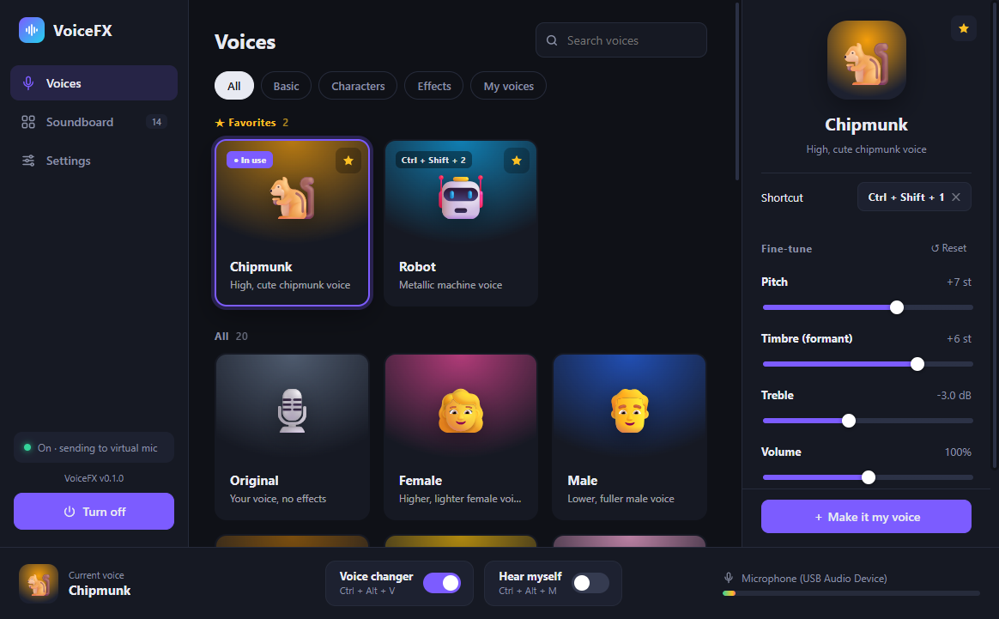
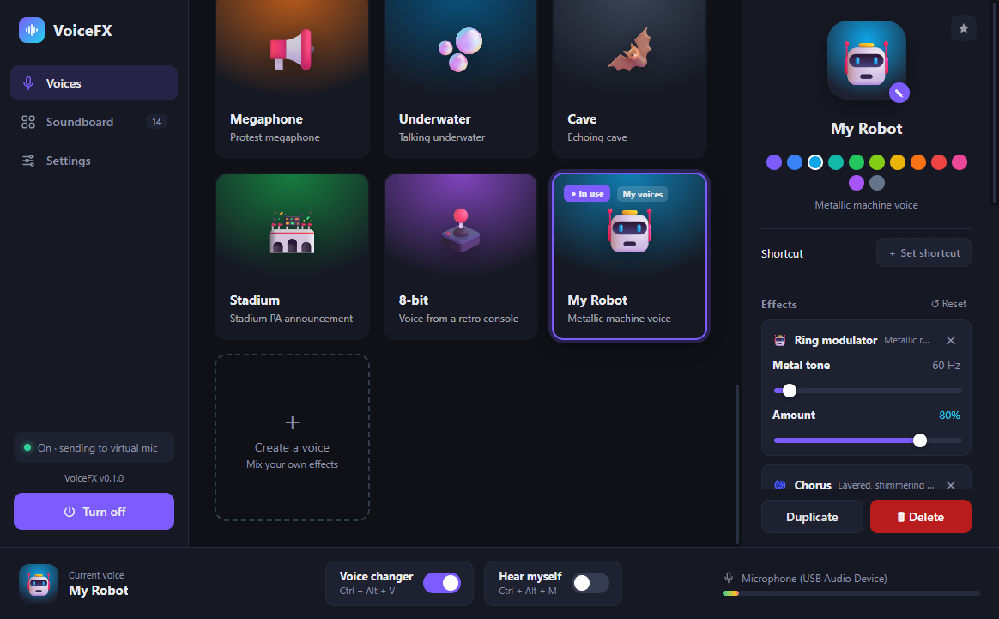
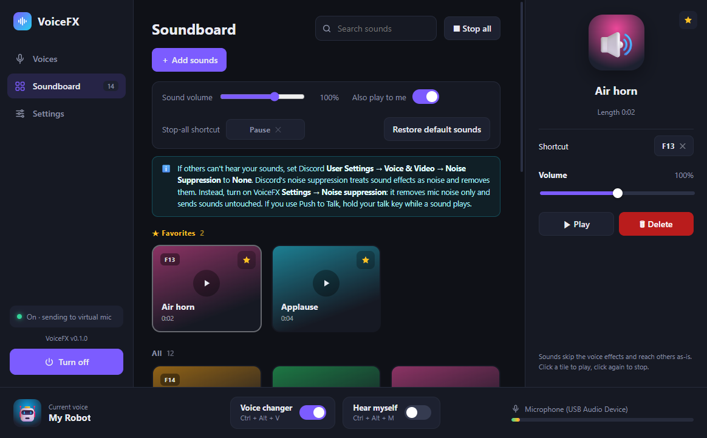
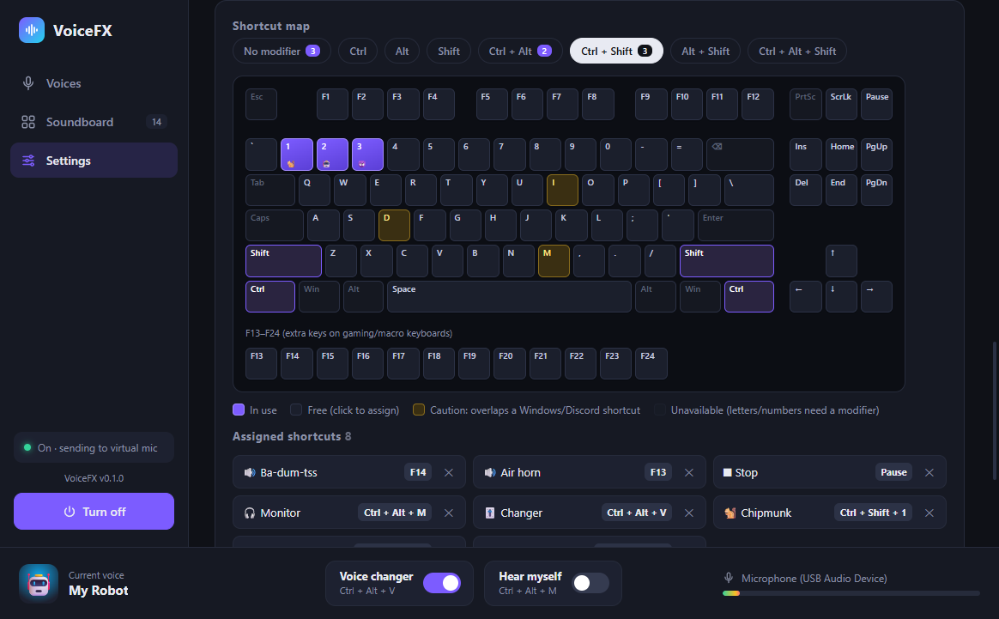

<p align="center"></p>

<h1 align="center">VoiceFX</h1>

<p align="center">
  <a href="README.md">English</a> · <b>한국어</b> · <a href="README.ja.md">日本語</a> · <a href="README.zh-CN.md">简体中文</a>
</p>

Discord·게임·OBS에서 쓸 수 있는 Windows용 실시간 보이스 체인저 + 사운드보드.

```
[실제 마이크] → VoiceFX(소음 억제 → 목소리 효과) ─┬→ CABLE Input ──(VB-CABLE)──> CABLE Output → Discord
                          사운드보드 ──────────────┘  └→ 헤드폰 (내 목소리 듣기)
```

## 스크린샷
<table>
  <tr><td width="50%"><br><sub>목소리 — 선택한 목소리 세부 조절</sub></td><td width="50%"><br><sub>효과 모듈로 내 목소리 만들기</sub></td></tr>
  <tr><td width="50%"><br><sub>사운드보드</sub></td><td width="50%"><br><sub>단축키 맵</sub></td></tr>
</table>

## 설치
1. [Releases](../../releases)에서 **`VoiceFX-Setup-x.y.z.exe`**를 받아 실행합니다. 관리자 권한은 필요 없습니다.
   설치 없이 쓰려면 `VoiceFX-x.y.z-portable.zip`을 풀고 `VoiceFX.exe`를 실행하세요.
2. **VB-CABLE**(무료 가상 오디오 장치)이 없다면 설치 마지막에 다운로드 페이지가 열립니다.
   받은 압축을 풀고 `VBCABLE_Setup_x64.exe`를 **관리자 권한으로 실행** → Install Driver → 재부팅.
3. VoiceFX를 실행하면 바로 켜집니다. Windows 기본 마이크를 `CABLE Output`으로 바꾸므로,
   Discord 입력 장치가 **Default**면 따로 설정할 것이 없습니다. 끄거나 종료하면 원래 마이크로 되돌립니다.
4. Discord **사용자 설정 → 음성 및 비디오**에서 **소음 억제(음성 격리)**를 **없음**으로 바꾸세요.
   Discord 소음 억제는 목소리 효과와 사운드보드를 잡음으로 지워버립니다. 잡음 제거는 VoiceFX의 소음 억제가 대신합니다.
   에코 제거·자동 게인 조절도 끄면 더 깔끔합니다.

요구 사항: Windows 10/11 64비트, Microsoft Edge WebView2 런타임(Windows 11에는 기본 포함), VB-CABLE.

## 기능
- **목소리 22종**: 여성·남성·아기·헬륨·거인·괴물·악마·우주 악당·로봇·외계인·유령·무전기·전화·확성기·수중·동굴·경기장·8비트 등.
  목소리를 고르면 오른쪽 패널에서 높이·음색·울림 같은 핵심 값을 조절합니다 (통화 중에도 바로 적용, 자동 저장).
- **내 목소리 만들기**: 효과 모듈 12종(피치·저음 자르기·EQ·링 모듈레이터·디스토션·비트크러시·고음 자르기·코러스·페이저·
  에코·리버브·컴프레서)을 골라 모든 값을 조절하고, 이름·아이콘·색을 정해 프리셋 카드로 저장합니다.
  기존 목소리를 복사해서 시작할 수도 있습니다.
- **사운드보드**: **＋ 사운드 추가** 또는 파일을 창에 끌어다 놓아 추가 (wav·mp3·flac·ogg, 3분 이하).
  목소리 효과·소음 억제 없이 상대방에게 그대로 전달되고, '내 귀로도 듣기'가 켜져 있으면 내 헤드폰에도 들립니다.
  기본 효과음 14개는 freesound.org의 CC0(퍼블릭 도메인) 소리입니다 (`voicefx/assets/sounds/CREDITS.md`).
- **소음 억제**: RNNoise 기반. 마이크 목소리의 키보드·팬·생활 소음만 지웁니다.
- **단축키**: 기본값 없이 직접 지정합니다. 목소리·사운드는 오른쪽 패널에서, 목소리 변조/내 목소리 듣기/사운드 모두 정지는
  설정에서, 또는 설정의 **단축키 맵**(키보드 그림)에서 키를 눌러 지정합니다. 다른 창이 앞에 있어도 동작합니다.
  관리자 권한으로 실행된 게임 안에서 안 먹으면 VoiceFX도 관리자 권한으로 실행하세요.
- **즐겨찾기**: 카드의 ★를 누르면 목록 맨 위에 모입니다.
- **언어**: 한국어·English·日本語·简体中文. 설정 → 화면 → 언어 (기본값은 Windows 언어를 따름).

설정·사운드·로그는 `%APPDATA%\VoiceFX`에 저장됩니다 (`settings.json`, `sounds\`, `voicefx.log`).

## 개발
```
pip install -r requirements.txt
python -m voicefx
```
Python 3.10 (64비트)에서 개발·테스트했습니다.

| 파일 | 역할 |
|---|---|
| `voicefx/launcher.py` | 진입점: 로그, 중복 실행 방지, `--restore`(제거 시 마이크 복구) |
| `voicefx/engine.py` | 마이크 → 소음 억제 → 효과 → 가상 케이블/모니터 오디오 엔진, 사운드 믹서, 지터 버퍼 |
| `voicefx/dsp.py` | Rubber Band R3 실시간 피치 시프터(높이·음색 분리), RNNoise 소음 억제, 링 모듈레이터 |
| `voicefx/presets.py` | 효과 모듈 12종과 기본 목소리 (모듈 조합 + 값) |
| `voicefx/controller.py` | 설정, 장치, 내 목소리, 사운드보드, 단축키, 기본 마이크·VB-CABLE 전환/복구 |
| `voicefx/soundboard.py` | 사운드 파일 추가/디코딩/삭제, 기본 효과음 |
| `voicefx/windefault.py` | Windows 기본 녹음 장치·장치 사용 여부 변경 (IPolicyConfig) |
| `voicefx/i18n.py`, `voicefx/locales/` | 다국어 (한국어 원문 → 번역) |
| `voicefx/webui.py`, `voicefx/ui/index.html` | GUI (pywebview) |
| `tools/` | 목소리 튜닝, 기본 효과음 받기, 아이콘 생성, 번역 도구 |

새 기본 목소리는 `presets.py`의 `PRESETS`에 모듈 조합(`recipe`)과 패널용 핵심 슬라이더(`quick`)를 추가하고,
`python tools/render_presets.py --record 5 --only <키>`로 들어보며 조정합니다.

### 번역
화면 문장은 한국어 원문이 그대로 번역 키입니다 (`t("...")` / 화면의 `T("...")`, 나머지 화면 글자는 자동 번역).
문장을 추가하거나 바꿨다면:
```
python tools/i18n_check.py          # 언어별 빠진 번역 확인
# tools/i18n_table.py 의 ROWS에 (한국어, English, 日本語, 简体中文) 한 줄 추가
python tools/i18n_table.py          # voicefx/locales/*.json 생성
```
새 언어를 추가하려면 `voicefx/i18n.py`의 `LANGUAGES`와 `tools/i18n_table.py`에 열을 하나 더하면 됩니다.

## 빌드
[Inno Setup 6](https://jrsoftware.org/isinfo.php)이 필요합니다 (`winget install JRSoftware.InnoSetup`).
```
pip install pyinstaller
powershell -ExecutionPolicy Bypass -File build.ps1
```
결과: `dist\VoiceFX\VoiceFX.exe`, `dist\VoiceFX-x.y.z-portable.zip`, `dist\VoiceFX-Setup-x.y.z.exe`.
`dist`의 VoiceFX를 실행 중이면 덮어쓸 수 없으니 닫거나 `-OutDir dist-test`처럼 다른 폴더를 지정하세요.

## 배포 (GitHub Releases)
1. `voicefx/__init__.py`의 `__version__`을 올리고 커밋합니다.
2. 같은 버전으로 태그를 올립니다: `git tag v0.1.0` → `git push origin v0.1.0`
3. GitHub Actions(`.github/workflows/release.yml`)가 Windows에서 빌드해 **초안(draft) 릴리스**에 설치 프로그램과 포터블 zip을 올립니다.
   내용을 확인한 뒤 GitHub에서 **Publish release**를 누르면 공개됩니다.

코드 서명이 없어서 처음 실행할 때 Windows SmartScreen 경고("Windows의 PC 보호")가 뜰 수 있습니다. 추가 정보 → 실행.

## 라이선스
[GPL-3.0](LICENSE). GPL 라이브러리(Rubber Band(pylibrb), pedalboard)를 포함하므로 앱 전체를 GPL-3.0으로 배포합니다.
기타 사용 라이브러리: RNNoise(BSD), pywebview(BSD), sounddevice/PortAudio(MIT), numpy(BSD), keyboard(MIT), pycaw(MIT),
comtypes(MIT). VB-CABLE은 포함하지 않으며 사용자가 직접 설치합니다. 기본 효과음은 CC0입니다 (`voicefx/assets/sounds/CREDITS.md`).
